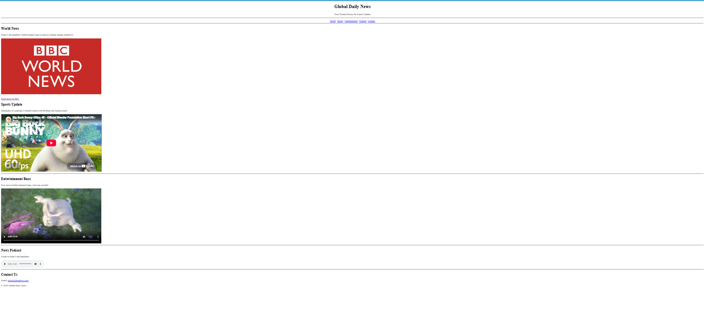

# Experiment 2 – Simple News Website

A simple multi-section news website built with HTML.

## Features
- Page header with title and tagline
- Navigation menu using anchor links (World, Sports, Entertainment, Podcast, Contact)
- **World News** section with an image and an external hyperlink
- **Sports Update** section with an embedded YouTube video (`<iframe>`)
- **Entertainment Buzz** section with an HTML5 video player (`<video>`)
- **News Podcast** section with an audio player (`<audio>`)
- **Contact Us** section with an email link and footer

## How to Run
1. Download or clone this repository
2. Open `index.html` in any web browser (or use the Live Server extension in VS Code)
3. An internet connection is needed for the YouTube video and the sample video/audio

## Output

## Outcome
- Successfully created a news website using HTML
- Used hyperlinks, images, and in-page navigation with anchors
- Embedded video and audio using `<iframe>`, `<video>` and `<audio>`
